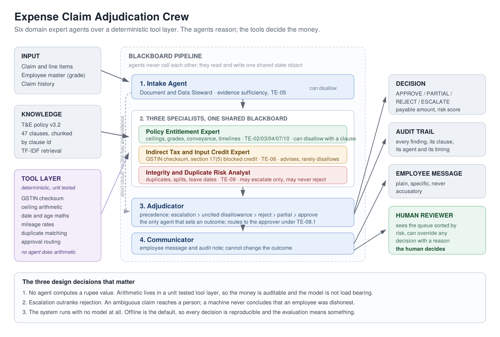

# Domain Expert AI Agents for Travel and Expense Adjudication

**Individual Assignment, Agentic AI**
PGDM (BDA) Batch 2025-27, FORE School of Management
Aman Aggarwal, Roll No. 065064

Repository: `expense-claim-agents` | Policy under review: Meridian Consulting India
Pvt. Ltd. T&E Policy v3.2

---

## 1. The business process and why it was chosen

Travel and expense (T&E) reimbursement is the most ordinary finance process in any
services firm, and that is exactly why it was chosen over something more exotic. It is
high volume, low value per transaction, and dense with rules. A mid size consulting
firm processes a few thousand claims a month against a policy of roughly fifty clauses,
and a finance associate has about ninety seconds for each one.

Three failures recur, and they are not the same failure:

**Leakage.** Over ceiling spend gets approved because nobody recomputes a grade
entitlement, net of tax, prorated across nights, at six on a Friday. The firm pays money
the policy says it should not.

**Friction.** A legitimate claim is queried because the reviewer is not sure, and the
employee spends a week chasing two thousand rupees. The cost is in trust and in the
reviewer's time, and it never appears in any ledger.

**No evidenced control.** The reason a claim was approved exists only in a reviewer's
head. When an auditor asks how the firm knows that its entitlement limits are enforced,
there is nothing to show.

A single model prompted with the whole policy can make a plausible decision here, but it
cannot do the three things that matter: produce the right number reliably, say which
clause the number came from, and behave differently when the stakes change. That is the
argument for a multi agent design, and it is an argument about division of expertise
rather than about throughput.

## 2. Why this is genuinely multi agent, and not one prompt in costume

The claim document is read by three different specialisms that reach different and
independent conclusions about it.

A hotel invoice from Bengaluru against a Haryana registration is **fully reimbursable to
the employee** and simultaneously **worthless as input tax credit to the company**. Those
are two correct answers to two different questions. A single reviewer, human or model,
conflates them, and the usual symptom is a claim that is approved at the wrong value or a
credit register that is quietly wrong all year.

The same separation holds between entitlement and integrity. Whether a meal exceeded a
daily ceiling is arithmetic. Whether a duplicate line is a duplicate is a judgement about
a person, and the correct institutional answer to it is almost always "ask a human". The
two questions deserve different agents with different authority, which is the design the
system implements.

## 3. Architecture



The topology is a **blackboard pipeline**: agents never call each other, they read from
and write to one shared state object. At any moment the blackboard can be printed and it
shows exactly what the system believes and which agent said it, which is what makes the
audit trail a property of the design rather than a logging afterthought.

```
Intake Agent
    |  (short circuit if no line carries any evidence)
Policy Expert  +  Tax Expert  +  Integrity Analyst     all read and write the blackboard
    |
Adjudicator        arbitration, the only agent that sets an outcome
    |
Communicator       employee message and audit note
```

A debate or negotiation topology was considered and rejected. Expense adjudication has a
deterministic ground truth: a ceiling is either breached or it is not. Agents arguing
about it adds latency and variance and destroys reproducibility, and it buys nothing that
arbitration against a fixed precedence order does not already give.

### The six agents and their authority

| Agent | Domain | May disallow | May escalate | May set outcome |
|---|---|---|---|---|
| Intake, Document and Data Steward | Evidence sufficiency, TE-05 | yes | yes | no |
| Policy Entitlement Expert | Ceilings, conveyance, timelines, TE-02/03/04/07/10 | yes, with a clause | yes | no |
| Indirect Tax Expert | GSTIN validity, blocked credit, TE-06 | rarely | yes | no |
| Integrity Risk Analyst | Duplicates, splits, leave dates, TE-09 | **no** | yes | no |
| Adjudicator | Outcome and routing, TE-08/11 | no | n/a | **yes** |
| Communicator | Employee message, audit note | no | no | no |

Each agent carries a written charter that is injected into its system prompt and that
also governs what its code is allowed to do. The charter is not decoration. A narrow
agent holding the three clauses that matter outperforms one large prompt holding fifty,
and the narrowness is also what makes each agent separately testable.

## 4. The three decisions this project would defend in a viva

### 4.1 No agent computes a rupee value

Every arithmetic operation, date calculation, checksum validation and threshold
comparison happens in `src/tools.py`, in ordinary Python with twenty unit tests behind
it. The language model is used for exactly two things: classifying a free text line whose
meaning is genuinely ambiguous, and writing the explanation a human reads.

This is the single most important choice in the project. A finance control that silently
miscalculates is worse than no control, because it is trusted. A function with tests can
be audited; a model's arithmetic cannot. The practical consequence is that the system
produces identical rupee amounts whether it is running against Llama 3.1 locally, against
Gemini, or against nothing at all.

### 4.2 Escalation outranks rejection

The Adjudicator applies a fixed precedence order, highest first:

1. Any integrity flag, or any finding that asks for a human, forces **ESCALATE**
2. A disallowance with no clause citation is invalid under TE-11.2 and becomes an escalation
3. If nothing payable survives, **REJECT**
4. If something was disallowed but a balance remains, **PARTIAL APPROVE**
5. Otherwise **APPROVE**

The order matters more than any individual rule, because it is what stops the system from
rejecting a person on a machine's say so. A suspected duplicate consequently disallows
nothing. It records the amount at risk in its evidence and hands the money decision to a
reviewer. Two genuine taxi rides from the same aggregator on the same day look identical
in the data, and the asymmetry of costs is stark: a few hundred rupees overpaid against a
false accusation of dishonesty made by software.

One refinement emerged from testing. An escalation about a line that is already being
disallowed in full cannot change the settlement, so the Adjudicator retires it as moot and
records that it did. Integrity flags are exempt, because TE-11.4 requires those to reach a
person whatever the money does.

### 4.3 The default path has no model in it

The offline provider is not a stub. Because the tool layer owns every decision that
touches money, the system with no model still produces a complete, correct and auditable
decision, and only the narrative wording becomes templated. Three things follow: anyone
who clones the repository can reproduce every number in it, the evaluation measures the
system rather than the weather inside a model, and a firm with a data residency
constraint can run the whole thing on a laptop with Ollama and nothing leaving the
building.

## 5. Implementation notes

**Policy retrieval.** The policy is chunked by clause identifier rather than by token
window, because a clause is the natural semantic unit of a finance rule and because
TE-11.2 requires every disallowance to cite one. Retrieval is TF-IDF with cosine
similarity in about forty lines of standard library code, which indexes 47 clauses and
needs no vector database or embedding service. For a corpus of this size that is not a
compromise; an embedding model would add a dependency and a download to retrieve from a
document shorter than this report.

**Where the model is actually used.** The Policy Expert sends a free text line and its
four nearest clauses to the model and asks a classification question: does this text fall
under one of these clauses? It never asks "is this allowed?" in the abstract. A small
local model can do the former reliably and cannot do the latter. The Communicator uses the
model to rewrite the templated employee message more naturally, and is explicitly forbidden
from restating an amount it was not given.

**Graceful degradation.** Every model call is wrapped so that a timeout, a bad key or
malformed JSON returns the deterministic fallback rather than raising. A finance run
should not fail because a server is slow.

**The CrewAI path.** `src/crew_runner.py` expresses the same agents and the same tools in
CrewAI, so the two designs can be compared directly and so the project can be run inside
the framework used in class. The native orchestrator remains the tested path, because it
is deterministic, runs with no model, and takes about one millisecond per claim against
seconds for the framework path. Both call the identical tool objects, so the arithmetic
cannot drift between them.

## 6. Evaluation

### 6.1 Method

44 claims were written covering clean cases, every category of partial disallowance,
rejections, escalations, and a set of edge cases chosen specifically to catch false
positives: a Saturday expense that carries an engagement code, a claim exactly 30 days
old, three round amounts in one claim, a meal in the city of posting.

The correct answer for each claim, both the outcome and the rupee disallowance, was
**written by hand from the policy text before the system was run**. Labels generated by
the system under test would measure nothing at all, which is the most common flaw in
agent project write ups.

Two error classes are reported separately because they cost different things:

- **Leakage**: money approved that policy says should have been stopped
- **Friction**: money stopped that policy says should have been approved

### 6.2 Results

```
Outcome accuracy                   44/44 = 100.0%
Exact match (outcome and rupees)   44/44 = 100.0%
Mean absolute rupee error          INR 0.00
Leakage (underblocked)             INR 0.00
Friction (overblocked)             INR 0.00
Escalations auto paid instead      0
Payable claims auto rejected       0
Mean latency per claim             0.1 ms

Confusion matrix (rows expected, columns predicted)
                       APPROVE   PARTIAL_A      REJECT    ESCALATE
APPROVE                     12           0           0           0
PARTIAL_APPROVE              0          11           0           0
REJECT                       0           0           7           0
ESCALATE                     0           0           0          14
```

### 6.3 Reading that honestly

A perfect score on a benchmark written by the same person who wrote the rules is a
measure of **internal consistency**, not of real world accuracy. It says the implementation
matches the author's reading of the policy. It says nothing about whether that reading
survives contact with real claims.

The first run was not perfect. It scored 40/44, and the four failures were instructive:

| Claim | Symptom | Diagnosis |
|---|---|---|
| CLM-2006 | Team lunch disallowed INR 3,000 instead of 1,000 | **System bug.** The daily meal ceiling was applied to a local claim, but TE-02.3 scopes it to outstation trips, and an internal team meal is governed by the per attendee cap in TE-03.4 instead. The same rupee was being disallowed twice under two clauses. |
| CLM-2007 | Escalated instead of partially approving | **System bug.** A missing vendor GSTIN forced human review on a line that was already disallowed in full, so the query could not change anything. Fixed by retiring moot escalations. |
| CLM-4008, CLM-4013 | Approved instead of escalating | **System bug.** Two escalation triggers were never wired to the decision: an entertainment pre approval breach set no human review flag, and the self approval check ran after the outcome had already been computed. |
| CLM-4014 | Rejected instead of escalating | **Label error.** TE-03.3 is unconditional: an unnamed attendee makes the claim non reimbursable. The system was right and the label was wrong. |

The label was corrected and the correction is recorded in the dataset note rather than
quietly applied, because changing a label after seeing a result is the easiest way to
produce a meaningless benchmark and the correction only stands because the policy text
is explicit.

### 6.4 The stress test is the better evidence

Because the labelled benchmark is self authored, a property based test was added that
asserts invariants which must hold for **any** input, rather than expected answers for
particular inputs.

| Invariant | Holds |
|---|---|
| I1 Determinism, the same claim twice gives the same answer | yes |
| I2 Monotonicity, raising an amount never lowers the disallowance | yes |
| I3 Boundary exactness, a value exactly at a ceiling is inside it; one rupee over is caught | yes |
| I4 Conservation, payable plus disallowed always equals claimed | yes |
| I5 An integrity flag never produces an automatic rejection | yes |
| I6 Vendor case and spacing do not defeat duplicate detection | yes, after a fix |
| I7 Every rupee disallowed cites a clause | yes |
| Fuzz, 300 randomly perturbed claims | no crash, no impossible total |

I6 failed on its first run, and the defect was real. Vendor names were compared with a
bare lowercase strip, so `uber  india` and `Uber India` were different merchants and a
duplicate passed straight through. A control defeated by a space is not a control. The
fix was a normalisation function that strips punctuation and corporate suffixes, and it
is now unit tested. The label based benchmark would never have found it, because the
benchmark only contains vendor names spelled consistently. That is the argument for
property based testing over example based testing in a control environment.

## 7. Limitations

1. **The receipts are structured records, not images.** A production system needs OCR and
   document understanding over the actual PDF or photograph, and every field read here
   would in reality be an extraction with its own error rate. That error rate would
   dominate everything measured in section 6.
2. **The benchmark is synthetic and self authored.** 44 claims written by the author.
   Real claims are messier in ways that are hard to imagine in advance.
3. **Integrity detection is rule shaped.** It catches the patterns it was told about.
   Genuine fraud detection needs labelled historical outcomes and a model trained on them,
   which no student project has access to.
4. **The policy is fictional.** A real deployment begins with a policy that contradicts
   itself in three places, which is a discovery problem before it is an engineering one.
   The system does surface one such gap: TE-02.3 sets no ceiling for a meal in the city of
   posting, so the Policy Expert raises an advisory flagging the gap for the policy owner
   rather than inventing a limit.
5. **Model variance is unmeasured on the default path.** Offline is deterministic by
   construction. Running with a live model would introduce variance in free text
   classification, and that variance should be measured across repeated runs before anyone
   trusts it.

## 8. What would come next

In priority order, and each is a real piece of work rather than a sentence:

- **Document understanding.** Receipt images to structured lines, with a confidence score
  per field, and an explicit rule that a low confidence extraction escalates rather than
  guesses.
- **Measure the model path.** Run the full benchmark ten times against a local model and
  report the variance in the free text classification, which is the only place a model can
  change an outcome.
- **Learn from overrides.** The front end already captures every human override with a
  written reason. Those are the most valuable labels in the system, and after a few
  thousand claims they would say far more about where the rules are wrong than any
  synthetic benchmark.
- **Policy versioning.** Clause level diffs between policy versions, so a claim is always
  adjudicated against the policy in force on its expense date rather than the policy in
  force today.

## 9. Running it

```bash
python run_review.py --claim CLM-4015      # one claim in full detail
python -m eval.evaluate                    # the benchmark in section 6
python -m eval.stress_test                 # the invariants in section 6.4
python tests/test_tools.py                 # 20 unit tests
streamlit run app/streamlit_app.py         # the reviewer front end
jupyter notebook notebooks/demo.ipynb      # the walkthrough
```

Nothing above needs an API key. To run with a model, copy `.env.example` to `.env` and
set `LLM_PROVIDER` to `ollama`, `gemini` or `openai`.

---

### Appendix: policy clauses implemented

| Section | Covers | Implemented in |
|---|---|---|
| TE-02 | Grade entitlement matrix, hotel and meal ceilings, travel class | `check_hotel_ceiling`, `check_meal_ceilings`, `check_travel_class` |
| TE-03 | Meals, alcohol, entertainment, team meals | `check_alcohol`, `check_entertainment`, `check_team_meal` |
| TE-04 | Conveyance, commute window, mileage rates, cab thresholds | `check_cab_rules`, `check_mileage`, `check_fuel_with_mileage` |
| TE-05 | Evidence, tax invoices, legibility, missing receipt declarations | `check_evidence` |
| TE-06 | GSTIN validity, section 17(5) blocked credit, cross state supply | `validate_gstin`, `check_gst` |
| TE-07 | Submission timelines, 30 and 60 day boundaries | `check_timeliness` |
| TE-08 | Approval authority ladder, self approval prohibition | `route_approval` |
| TE-09 | Duplicates, splits, round amounts, leave dates, velocity | `detect_duplicates_*`, `detect_splits`, `detect_round_amounts` |
| TE-10 | Non reimbursable list, laundry rules | `check_non_reimbursable_text`, `check_laundry` |
| TE-11 | Outcome definitions and precedence | `AdjudicatorAgent` |
